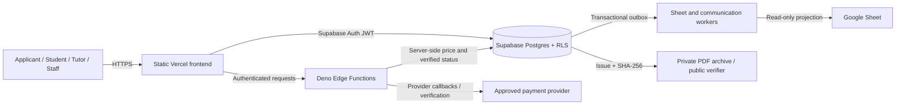

# AH Consult Ltd — Professional Services and Student Hub

**Current source version:** V18.8.1  
**Review posture:** source-review candidate; not production-certified or presented as an authorized public demonstration.

AH Consult Ltd combines a professional-services website with a distinct Student Hub for training, applications, learner access and staff workflows. The repository contains the static frontend, Supabase database migrations and Edge Functions, operational guidance, and automated quality checks that support those journeys.

## What this repository contains

- A corporate public website for architecture, construction, interior design and consultancy.
- A separate public Student Hub for course discovery, training applications, student access and staff access.
- A governed Supabase platform for admissions, payments, academic records, student documents, role-based administration and a read-only Google Sheets reporting mirror.
- Seventeen Supabase Edge Functions and forty-three ordered database migrations.
- Unit, browser, SQL, security-posture and load-test starter coverage, with CI checks for secrets, static quality, Deno functions, SQL migrations and vendored assets.

## Repository guide

| Location | Purpose |
| --- | --- |
| `frontend/` | Public pages, styles, browser scripts and deploy configuration. |
| `supabase/` | Ordered SQL migrations, Edge Functions and safe configuration examples. |
| `tests/` | Unit, browser, SQL and load-test starter checks. |
| `scripts/` | Local validation, deployment helpers and configuration generation. |
| `docs/` | Architecture, operations, policy, review, release and archival material. |
| `sheets/` | Read-only reporting-mirror Apps Script. |

Start with the [documentation guide](docs/README.md), then use the [panel review guide](docs/PANEL_REVIEW.md) for a focused evidence route.

## System overview



The architecture, decision records and trust boundaries are described in [Architecture](docs/ARCHITECTURE.md). Operational deployment and recovery guidance is in the [runbook](docs/RUNBOOK.md).

## Current release and review materials

The current source release separates the corporate website from the Student Hub while retaining all governed student and staff workflows. Read the [V18.8.1 deployment guide](docs/releases/DEPLOY_V18_8_1.md) before staging or deployment. Earlier release guides are indexed in [Release history](docs/releases/README.md).

The illustrative six-page document preview uses synthetic records and visible sample markings; it is not a production-issued document. See [the sample preview](docs/samples/AHCT_Native_Document_Illustrative_Preview.pdf) and the accompanying [sample notes](docs/samples/README.md).

## Security and external-review boundary

The checked-in public browser configuration is deliberately inert. Deployment generates `frontend/js/config.js` from public environment variables using `npm run configure:frontend`; service-role, payment-provider and Google credentials must never be placed in the browser or committed to source.

Do not treat this source package as evidence of production authorization, penetration testing, international accreditation or completed operational controls. The repository’s security incident response and remaining owner actions are documented in [Security incident response](docs/SECURITY_INCIDENT_RESPONSE.md) and [SECURITY.md](SECURITY.md). Any external distribution should exclude `.git/`, local Supabase state and populated environment files.

## Local validation

Install locked Node dependencies, then run the cross-platform static and unit checks:

```bash
npm ci
npm run check
```

The validation command discovers a suitable Python 3 launcher on Windows, macOS and Linux. Full release validation also requires:

- An isolated PostgreSQL database for `scripts/test-sql.sh`.
- Deno for Edge Function type checks and unit tests.
- A staging project with synthetic data for browser, payment-provider and access-control verification.

Review the exact deployment prerequisites in [Installation notes](docs/INSTALLATION_NOTES.md) and the current release guide before making any production change.

