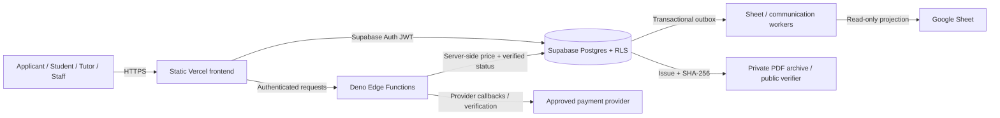

# AHCT Student Hub — secure training, admissions and academic operations

**V18.6.1 source remediation · 28 October 2026 · client work, not an authorized public demo**

AH Consult manages admission requests, secure student accounts, payments, academic records, tutor activities and verified institutional documents through one portal. Applicants need a clear journey from choosing training to payment and receipt retrieval; staff need audited, role-appropriate workflows that are reliable on desktop and mobile.

## Who uses it?

**Applicants** register and track an admission/payment. **Students** access their academic workspace and verified documents. **Tutors** manage learning workflows. **Administration and finance** review, reconcile and issue institutional records. Google Sheets serves as a **read-only reporting mirror**, never the source of authority.

## Architecture



**Current repository:** `frontend/` has 12 application HTML pages plus 2 draft legal information pages, CSS and self-hosted libraries. `supabase/migrations/` contains **34 unchanged ordered migrations (001–034)**; `supabase/functions/` has **16 Edge Functions** and `_shared/` helpers. `tests/` includes unit/DOM, SQL and browser smoke tests. CI checks page structure, lint, unit tests, Deno, SQL, vendored assets and secret leakage.

## Security characteristics

Database RLS, backend-set prices, payment provider verification, an append-only audit log, SHA-256 receipt validation, no spreadsheet write authority, self-hosted scripts and a CSP that forbids inline JavaScript. **Open items:** mandatory staff TOTP, production CAPTCHA/email confirmation and source/history credentials rotation. Do not claim the system is penetration-tested or internationally certified. [See security response](docs/SECURITY_INCIDENT_RESPONSE.md).

## Local checks

```bash
npm ci
npm run check
# Requires an isolated PostgreSQL test database
DATABASE_URL='postgres:///your_disposable_test_database' ./scripts/test-sql.sh
# Requires Deno
for d in supabase/functions/*/; do [ "$(basename "$d")" = _shared ] || deno check "${d}index.ts"; done
```

The committed public configuration is intentionally inert. Supply `AHCT_SUPABASE_URL` and `AHCT_SUPABASE_ANON_KEY` to `npm run configure:frontend` at build time, and use separate `AHCT_STAGING_URL` and `AHCT_STAGING_ANON_KEY` for local synthetic tests. Deploy the `frontend/` directory to Vercel and Supabase migrations and functions using the instructions in [installation notes](docs/INSTALLATION_NOTES.md). Do not use production keys or real students to test.

## Demo / visuals

The original student and staff page layouts, route names and brand tokens (orange `#ea580c`, ink `#171717`) are intentionally retained. Before publication: capture and approve desktop/tablet/mobile screenshots using the existing browser smoke test (`tests/browser/homepage.browser.mjs`), use a **separate synthetic-data project**, and obtain AH Consult's **written permission** to publish this client case study. No production environment URL or demo credentials are bundled.

## Documentation

[Architecture and decisions](docs/ARCHITECTURE.md) · [Operations runbook](docs/RUNBOOK.md) · [Release gate](docs/RELEASE_V18_6_1.md) · [Security](SECURITY.md) · [Roadmap](docs/ROADMAP.md) · [Changelog](CHANGELOG.md)
